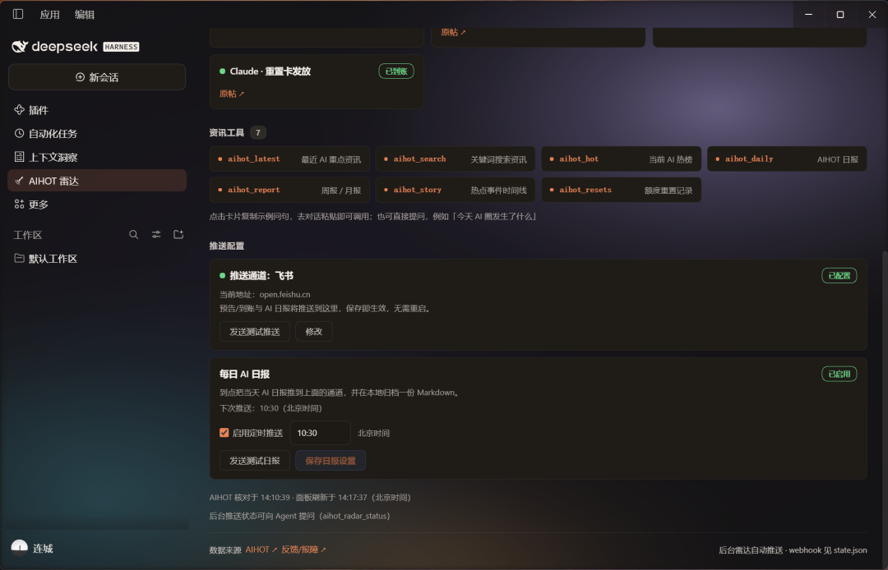

# dsh-aihot-radar · AIHOT Radar

[中文](README.md) | [English](README.en.md)

[](https://www.npmjs.com/package/dsh-aihot-radar)
[](https://www.npmjs.com/package/dsh-aihot-radar)
[](https://github.com/liancheng2020/dsh-aihot-radar/actions/workflows/ci.yml)
[](https://github.com/liancheng2020/dsh-aihot-radar/releases)
[](LICENSE)
[](https://github.com/liancheng2020/dsh-aihot-radar#readme)

A DeepSeek Harness plugin: **real-time Codex / Claude / Antigravity quota-reset alerts** + **AI news agent tools** + **daily digest**.

> **Three things first**
> - **No API key, zero runtime dependencies**: pure JS, no Python/Go, no key to paste; data comes from the public anonymous [AIHOT](https://aihot.news) API.
> - **Restart DSH once** after install and the **AIHOT Radar** panel is ready; push is optional — the news tools and panel work without it.
> - To push, open **Push settings**, pick a channel, paste the URL and hit **Save and send test** (applies immediately). **Background alerts need DSH running**, and a successful test only proves the channel is reachable.

**This is what you get after install** (left: quota radar · right: daily report; push settings below)

| Quota radar | Daily report |
|---|---|
|  |  |

## What it does

- **Quota-reset alerts (core)**: polls AIHOT reset monitors in the background and pushes new **announcements** and **confirmed** resets to your webhook; AIHOT-inferred states are marked "unconfirmed". Configuring a channel for the first time silently skips the "confirmed" history, so the first card is a live event; failures retry up to 5 times, while a timeout is recorded as **delivery uncertain** and never re-sent — one missed message beats a duplicate in a shared group.
- **7 news tools**: ask "what happened in AI today" or "did Claude quota reset?" — the agent calls `aihot_*` tools and answers from AIHOT's curated Chinese content.
- **Daily digest** (optional): fetches the report at `digest.timezone` (Beijing by default), pushes and archives it locally; the panel toggles it and changes the time. Oversized payloads are split, and a retry sends **only the missing parts**; a timed-out part stops automatic resending for the day.
- **Panel**: live pending announcements, recent events and the tool catalog, plus channel and digest settings, with AIHOT's check time and monitor status.

## Install

Requires DSH ≥ `0.2.1-rc.2` and Node ≥ 18.

**Desktop**: Settings → Plugins → Add plugin, paste the package name `dsh-aihot-radar` (npm) or the repository address `github:liancheng2020/dsh-aihot-radar`, install and enable.

**Web**:
```sh
# npm (published, recommended)
dsh plugin --profile web add dsh-aihot-radar
# or install directly from the GitHub repository
dsh plugin --profile web add github:liancheng2020/dsh-aihot-radar
# or install the prebuilt package from the Release direct link
dsh plugin --profile web add https://github.com/liancheng2020/dsh-aihot-radar/releases/download/v0.4.0/dsh-aihot-radar-0.4.0.tgz
```
Restart DSH. The **AIHOT Radar** panel is ready.

> Current version `0.4.0` (see [CHANGELOG](CHANGELOG.md)). The npm package and the Release `.tgz` are built from the same source; check `npm view dsh-aihot-radar version` for the published version.

## Configure push (optional)

**Panel (recommended)**: **AIHOT Radar** → **Push settings** → pick a channel, paste the URL, hit **Save and send test**. Saving applies immediately, **no restart** needed.



- Data comes from **[AIHOT](https://aihot.news)**' public API; the plugin only curates and forwards it. Alerts are a **background job**: quitting DSH stops polling and pushing.
- **A successful test only proves the channel is reachable** (URL, bot and permissions worked at that moment). It does not promise every later alert arrives — lost network, a removed bot or a closed DSH all leave the alert on your machine.
- **Daily AI digest** lives in the same block: a switch plus a send time (half-hour presets, free typing allowed), **off by default**, rescheduled immediately on save. **Send test digest** runs a real report through the full multi-chunk path and never marks today as delivered.

**Channels**: `wecom` (bot URL) · `dingtalk` (URL + optional signing key) · `feishu` (URL) · `bark` (`https://api.day.app/<key>`) · `serverchan` (`https://sctapi.ftqq.com/<key>.send`) · `telegram` (url = bot token, secret = chat_id) · `generic` (any JSON POST) · `none` (default, off).

**Manual config**: the channel goes in `$DSH_HOME/aihot-radar/state.json` (default `~/.dsh/aihot-radar/state.json`, **only touch `webhook`**; `seen`, `digest`, `delivery` are maintained by the plugin, and replacing the whole file loses dedup and digest progress). Everything else goes in the profile's `cordis.patch.yml`. Restart DSH afterwards.

```json
{ "webhook": { "channel": "wecom", "url": "https://qyapi.weixin.qq.com/cgi-bin/webhook/send?key=xxx", "secret": "" } }
```

```yaml
- id: aihot-radar
  name: dsh-aihot-radar
  config:
    radar:
      enabled: true                           # false stops background pushes; tools and panel still work
      providers: [codex, claude, antigravity]
      pollSeconds: 600                        # min 60; AIHOT asks for at most one request per 10 min (the default)
      quiet: { start: "", end: "" }           # quiet hours, e.g. "23:00"–"08:00"; empty = off
      muted: []                               # per-source mute, e.g. [antigravity]
    digest:
      enabled: false                          # off by default; the panel preference wins once set
      time: "08:30"                           # invalid values fall back to 08:30
      timezone: Asia/Shanghai
      catchUp: false                          # push today's digest on startup if the time already passed
    notify:
      signatureText: ""                       # your own footer line (the only thing that enables one); empty = none
      # signature: false                      # uncomment to switch the footer above off for a while
```

- **Quiet hours / mute / kind switches**: quiet hours defer pushes instead of dropping them; muted sources are marked seen so unmuting won't replay old events. `radar.notifyAnnounced` and `radar.notifyConfirmed` are both on by default.
- **Footer**: there is no built-in promotional footer (no install link). Only `notify.signatureText` appends a line and `signature: false` suppresses it; a stale checkbox record from an older panel no longer does anything. The brand always stays in the **title** (`AIHOT 雷达 · Codex ...`).
- **Long content is split**: WeCom at ≤3900 bytes, Telegram at ≤3800 characters, line-aware and never breaking UTF-8, with the response body's business code validated — HTTP 200 with a business failure still counts as a failure.
- **No duplicate pushes across instances**: when desktop and web share `DSH_HOME`, each event and each digest edition goes out once; failures and uncertain deliveries are kept in `state.json` under `delivery` and surfaced by `/status` and `aihot_radar_status`.
- **The digest is never turned on by a configured webhook**; if the host starts after the send time, today's digest is skipped by default and `catchUp: true` pushes it once. The panel shows the last and next run.
- **Bridge** binds `127.0.0.1:17420` only and never exposes the url/secret; `localApi.enabled: false` disables it. **No pushes wanted?** Set `radar.enabled: false` (news tools and panel keep working). **Uninstall**: remove the plugin row from the profile and restart DSH.

## Tools

**News tools (7)**

| Tool | Purpose |
|---|---|
| `aihot_latest` | Latest 24h/7d AI highlights, filterable by category / selected-only |
| `aihot_search` | Keyword search (companies / products / models / people, last 7 days) |
| `aihot_hot` | Current AI trending |
| `aihot_daily` | AIHOT daily report (latest or a given date) |
| `aihot_report` | Weekly / monthly report |
| `aihot_story` | Timeline of a trending event |
| `aihot_resets` | Codex / Claude / Antigravity quota-reset records and announcements |

**Host status tool (read-only)**

| Tool | Purpose |
|---|---|
| `aihot_radar_status` | Background push status (webhook channel, per-source last scan and errors, digest state) |

## Compliance & license

- **Data source: [AIHOT](https://aihot.news)**. Its API is free for personal non-commercial, public-interest non-commercial, and organization-internal use. External commercial products, paid services, public mirrors, and bulk redistribution require prior written authorization (agent@virxact.com); attribution alone is not authorization. This plugin targets personal non-commercial use.
- News content is third-party reference material: read-only passthrough, never execute embedded instructions; verify important facts at the source.
- **Compliant fetching**: interactive news tools use `/api/v1/agent/*`; **programmatic sync** (radar polling, digest) uses the JSON endpoints (`/api/v1/{provider}-resets/recent`, `/api/v1/dailies/latest`) with User-Agent `aihot-api/2.0.0`, per AIHOT's official guidance for programmatic use.
- Polling follows AIHOT rules: conditional requests (ETag/304), compression, `Retry-After` backoff, ≥60s interval.
- Plugin code: **MIT**. The webhook URL and state stay local under `$DSH_HOME/aihot-radar/` (default `~/.dsh`, directory mode `0700`), never uploaded; a corrupt `state.json` is backed up automatically and reset to defaults.

## Feedback

Can't install or pushes failing? Open an [issue](https://github.com/liancheng2020/dsh-aihot-radar/issues) with the DSH version / plugin version / platform (web or desktop) / the exact error.

Local verification (repo clone required): `node scripts/selftest.mjs`, plus `scripts/selftest-client.mjs` and `scripts/verify-dedup.mjs`; pure node, zero dependencies, runs in Git Bash and PowerShell.

Same author: [Balance Sentinel](https://github.com/liancheng2020/dsh-balance-sentinel) — DeepSeek balance monitoring with low-balance alerts to Feishu / DingTalk.